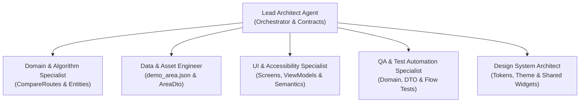

# Orkiestracja Agentów AI i Podział Obowiązków
**Projekt:** „Trasa bez domysłów” — Kraków bez barier (HackYeah 2026)  
**Cel:** Skalowalny, wieloagentowy rozwój systemu w standardzie Enterprise, z izolacją kontekstu, precyzyjnymi rolami i ścisłą kontrolą jakości (TDD).  
**Specyfikacja źródłowa:** `SPEC_KRAKOW_BEZ_BARIER_AI(1).md`

---

## 1. Role Agentów i Podział Obowiązków (Role Division)

### 1.1. Lead Architect Agent (Główny Architekt & Koordynator)
- **Odpowiedzialność:**
  - Definiowanie interfejsów w `lib/domain/repositories/` i encji w `lib/domain/entities/`.
  - Pilnowanie reguł Clean Architecture (`presentation → domain ← data`), braku generatorów kodu (brak Freezed/build_runner) i wstrzykiwania zależności w `lib/core/di/providers.dart`.
  - Integracja całości i weryfikacja stabilności kompilacji.
- **Dostęp do plików:** `lib/core/**`, `pubspec.yaml`, `docs/**`.

### 1.2. Domain & Algorithm Specialist (Specjalista Domeny i Grafów)
- **Odpowiedzialność:**
  - Implementacja czystej logiki w `lib/domain/entities/**`, `lib/domain/repositories/**` oraz use case'ów (`CompareRoutes`, `LoadArea`, `AddObservation`).
  - Determinizm reguł: wykluczenie potwierdzonych schodów (`odrzucona`), konflikt = `niepewna`, próg **90 dni** dezaktualizacji danych, sortowanie tras (nieodrzucone, mniej barier, krótszy dystans).
- **Dostęp do plików:** `lib/domain/**`.
- **Zasada twarda:** Czysty Dart. Kategoryczny zakaz importowania Fluttera, Riverpoda, mapy czy pamięci urządzenia do warstwy domeny.

### 1.3. Data & Asset Engineer (Inżynier Danych i Źródeł)
- **Odpowiedzialność:**
  - Przygotowanie pliku danych `assets/data/demo_area.json` z poprawnym schematem (`schema_version: 1`, top-level `observations`, `stairs: absent` na Trasie B dla celów demonstracji konfliktu).
  - Implementacja `AreaDto` z pełną walidacją przy starcie aplikacji.
  - Implementacja `AssetJsonSource` oraz `PreferencesSource` (z `SharedPreferencesAsync` i metodą `clearDemoData()`).
- **Dostęp do plików:** `assets/data/**`, `lib/data/**`, `scripts/validate_graph_json.dart`.

### 1.4. UI & Accessibility Specialist (Specjalista UI, ViewModeli i a11y)
- **Odpowiedzialność:**
  - Implementacja ekranów: `RouteSetupScreen`, `RouteComparisonScreen`, `PlaceDetailScreen`.
  - ViewModele z Riverpod (`Notifier` / `AsyncNotifier`): `RouteSetupVm`, `RouteComparisonVm`, `PlaceDetailVm`.
  - Widgety i dostępność: `RouteCard`, `StatusBadge`, `RouteSteps`, `MapPreview`.
  - Responsywność: układ jednokolumnowy dla telefonu (<600 px), dwupanelowy dla tabletu (>=600 px).
  - Semantyka `Semantics`, cel dotykowy >= 48dp, odporność na `TextScaler(2.0)`.
- **Dostęp do plików:** `lib/presentation/**`.

### 1.5. QA & Test Automation Specialist (Inżynier Testów i Jakości)
- **Odpowiedzialność:**
  - Automatyzacja testów: `test/domain/compare_routes_test.dart`, `test/data/area_dto_test.dart`, `test/presentation/route_flow_test.dart`.
  - Automatyzacja pełnego scenariusza jurorskiego krok po kroku.
  - Generowanie raportu Markdown `docs/TEST_RESULTS_AND_A11Y_AUDIT.md`.
- **Dostęp do plików:** `test/**`, `scripts/**`.

### 1.6. Design System Architect (Architekt Systemu Designu)
- **Odpowiedzialność:**
  - Architektura i wdrożenie scentralizowanego systemu designu w `lib/core/design_system/`.
  - Izolacja warstw stylistycznych: tokeny prymitywne, tokeny semantyczne, motyw (ThemeData, ThemeExtension), style komponentów, współdzielone widgety.
  - Zapewnienie jednokierunkowych zależności i egzekwowanie, aby ekrany (features) używały wyłącznie publicznego API `design_system.dart`.
  - Weryfikacja projektu (grep/lint), eliminacja sztywnych wartości (magiczne liczby, kolory w heksach) i zapewnienie ergonomii użycia (np. `context.colors.primary`).
- **Dostęp do plików:** `lib/core/design_system/**`, oraz uprawnienia do refaktoryzacji widoków w `lib/presentation/**` w celu wdrożenia tokenów.

---

## 2. Zarządzanie Kontekstem i Granice Modułów (Context Management)
1. **Izolacja Warstw:** Każdy subagent ładuje tylko pliki ze swojej strefy odpowiedzialności.
2. **Brak generatorów kodu:** Żaden agent nie uruchamia `build_runner`. Wszystkie modele i DTO pisane są ręcznie w czytelnym, idiomatycznym Darcie z metodami `fromJson` i `copyWith`.
3. **Komunikacja:** Po zakończeniu etapu agent przekazuje zwięzły raport: lista zmienionych plików, status testów, ewentualne uwagi architektoniczne.
